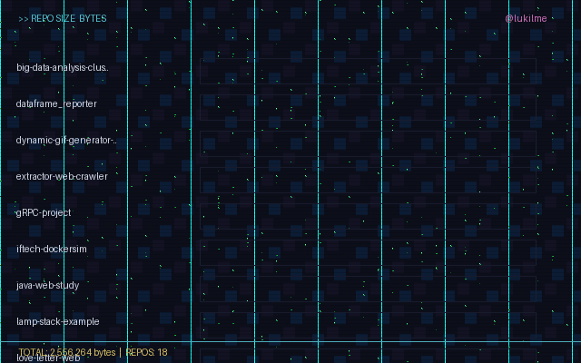

# Dynamic GIF Generator for GitHub README

Este projeto coleta dados de repositórios do GitHub e gera GIFs de dashboard para usar em um README do GitHub.

## Estrutura do projeto

```text
.
├── .github/
│   └── workflows/
├── assets/
│   └── gifs/
├── data/
│   └── github_profile.json
├── github_profile_gif/
│   ├── __init__.py
│   ├── collector.py
│   └── plotter.py
├── plots/
│   └── ... módulos dos gráficos
├── .gitignore
├── main.py
├── plot.py
├── requirements.txt
├── setup.py
└── README.md
```

## Fluxo

1. `main.py` consulta a API do GitHub e salva os dados em `data/github_profile.json`.
2. `plot.py` lê esse arquivo e gera os GIFs em `assets/gifs/`.
3. Os arquivos gerados podem ser inseridos em um README do GitHub com markdown.

## Como executar

```bash
python -m pip install -r requirements.txt
python main.py
python plot.py
```

## Observações

- Os artefatos gerados ficam fora da raiz para manter o projeto mais organizado.
- O diretório `plots/` concentra a lógica dos gráficos.
- `github_profile_gif/` centraliza a coleta e a geração do dashboard.
- O arquivo `.github/workflows/main.yml` está comentado intencionalmente para não executar automaticamente agora.

## Workflow do GitHub Actions

O projeto já inclui um workflow para atualizar o GIF automaticamente, mas ele foi deixado comentado para evitar execução imediata. Isso é útil quando você quer controlar manualmente quando os dados devem ser atualizados.

Para ativar a atualização dinâmica mais tarde, basta descomentar o conteúdo de `.github/workflows/main.yml` e realizar um commit no branch principal. O workflow pode rodar em:

- agendamento diário com `cron`
- execução manual via `workflow_dispatch`
- push na branch principal

Exemplo de cenário ativado:

```yaml
on:
  schedule:
    - cron: '0 0 * * *'
  workflow_dispatch:
  push:
    branches:
      - main
```

## Como usar no README do perfil do GitHub

1. Crie um repositório cujo nome seja exatamente o seu nome de usuário do GitHub, por exemplo:
   `github.com/seu-usuario/seu-usuario`
2. Faça o push deste projeto para esse repositório.
3. No arquivo `README.md` do perfil, adicione uma imagem vinculando ao GIF gerado.

Exemplo:

```md

```

Ou em HTML para maior compatibilidade:

```html

```

> O caminho da imagem deve apontar para o arquivo GIF gerado no seu repositório do perfil.

## Atualização dinâmica

Depois que o workflow estiver ativado, ele executa a coleta dos dados e gera novamente os GIFs automaticamente. Como o README do perfil usa a URL do arquivo no GitHub, o conteúdo do perfil atualiza assim que o GIF for regenerado e enviado ao branch principal.

Em resumo:

- o workflow coleta dados
- gera a imagem no diretório `assets/gifs/`
- o arquivo é commitado no repositório
- o README do perfil exibe a imagem mais recente

## Dica para README

```md

```

Se quiser, também posso preparar a versão final do arquivo README em português/inglês com uma apresentação mais profissional para publicar no GitHub.
